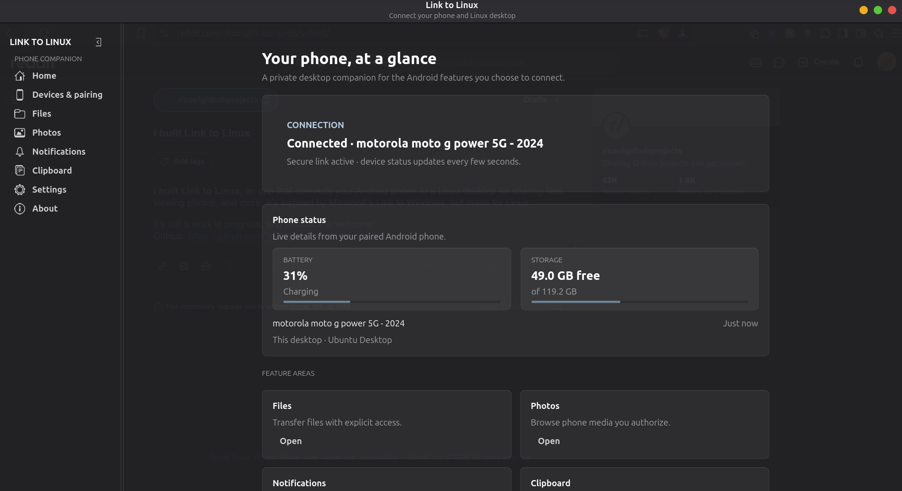
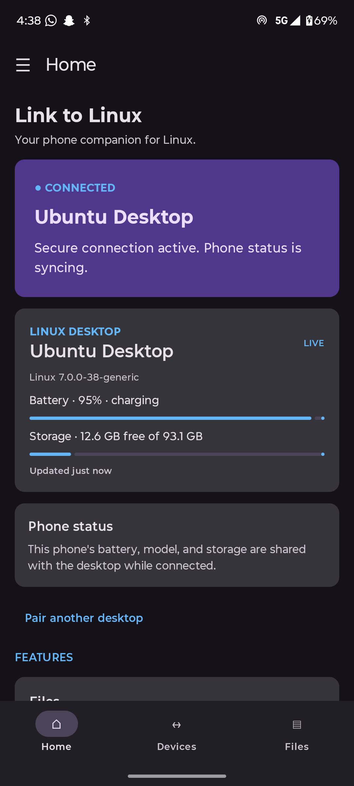

<p align="center">
  
</p>

<h1 align="center">Link to Linux</h1>

<p align="center"><strong>Connect your Android phone and Linux desktop.</strong></p>

Link to Linux is an Android companion and GTK desktop app for sharing selected phone features with a Linux computer over a local network. The project is built by **Young Jay** at **YoungTechsperts** and is inspired by Microsoft Link to Windows. It is an independent project and is not affiliated with Microsoft.

## Features

- Pair devices on the same local network by scanning a QR code or entering the desktop details.
- Reconnect to trusted devices and manage saved devices.
- Send files between Android and Linux and browse authorized phone photos from the desktop.
- View phone and desktop status, including battery and storage details.
- Control supported Android media sessions from the desktop, including track details and playback controls.
- Opt in to notification forwarding and text clipboard sharing.

Some features require Android permissions and an active connection. Media controls require Android notification access and a media app that exposes an active playback session.
Remote input lets an Android phone act as a touchpad and live text keyboard after you enable it on the desktop. File transfers show progress on Android, with human-readable file sizes. On Wayland, remote input requires `ydotool`, its user service, and distribution-specific `/dev/uinput` access.

## Downloads

Download the current APK and Linux packages from [GitHub Releases](https://github.com/Youngjay42-real/Link-to-linux/releases/latest). The release page includes Debian/Ubuntu, Fedora, and portable Linux builds.

To receive notifications for future releases, open the repository on GitHub and select **Watch → Custom → Releases**.

| Platform | Download |
| --- | --- |
| Android | [APK](https://github.com/Youngjay42-real/Link-to-linux/releases/latest/download/LinkToLinux-Android.apk) |
| Debian or Ubuntu | [`.deb` package on GitHub Releases](https://github.com/Youngjay42-real/Link-to-linux/releases/latest) |
| Fedora | [`.rpm` package on GitHub Releases](https://github.com/Youngjay42-real/Link-to-linux/releases/latest) |
| Other Linux distributions | [Portable archive on GitHub Releases](https://github.com/Youngjay42-real/Link-to-linux/releases/latest) |

## Screenshots

### Desktop



### Android

<p align="center"></p>

## Setup for development

### Linux desktop

On Ubuntu or Debian, install the GTK runtime and Python development tools:

```bash
sudo apt update
sudo apt install python3-gi gir1.2-gtk-4.0 gir1.2-adw-1 python3-venv python3-dev
```

Create an environment that can use the system GTK bindings, install the desktop app, and launch it:

```bash
python3 -m venv --system-site-packages desktop/.venv
source desktop/.venv/bin/activate
python -m pip install --upgrade pip
python -m pip install -e ./desktop
linktolinux
```

To add a launcher to the desktop Applications menu, run `packaging/install_desktop.sh` after installing the system packages above.

### Android app

Install Android Studio and Android SDK Platform 35, then open the `android/` directory. A debug build can be created with:

```bash
cd android
./gradlew assembleDebug
```

The APK is written to `android/app/build/outputs/apk/debug/app-debug.apk`.

To create a signed release build, make a signing key and local configuration. Keep both files private; they are excluded from Git.

```bash
keytool -genkeypair -v -keystore android/linktolinux-release.jks \
  -alias linktolinux -keyalg RSA -keysize 2048 -validity 10000
cp android/signing.properties.example android/signing.properties
```

Set the passwords in `android/signing.properties`, then build from the `android/` directory:

```bash
./gradlew assembleRelease
```

The signed APK is written to `android/app/build/outputs/apk/release/app-release.apk`. Keep a secure backup of the signing key: future APKs must use the same key to update existing installations.

## Pairing and permissions

Start pairing on the desktop, then scan its QR code in the Android app. Both devices should be on the same trusted Wi-Fi network. Android permissions are requested by the feature that needs them. Media control and notification forwarding require Link to Linux to be enabled in Android's **Notification access** settings.

## Project layout

- `android/` — Android app built with Kotlin and Jetpack Compose.
- `desktop/` — Python GTK4/libadwaita desktop app.
- `protocol/` — protocol notes and message validation.
- `docs/` — architecture, installation, protocol, and security notes.
- `packaging/` — Linux package and portable archive build scripts.

## About

Built by **Young Jay** at **YoungTechsperts**. [GitHub profile](https://github.com/Youngjay42-real) · [More projects](https://youngai.site) · [Discord community](https://discord.gg/sMC9cV9nfU)

## License

MIT. See [LICENSE](LICENSE).
