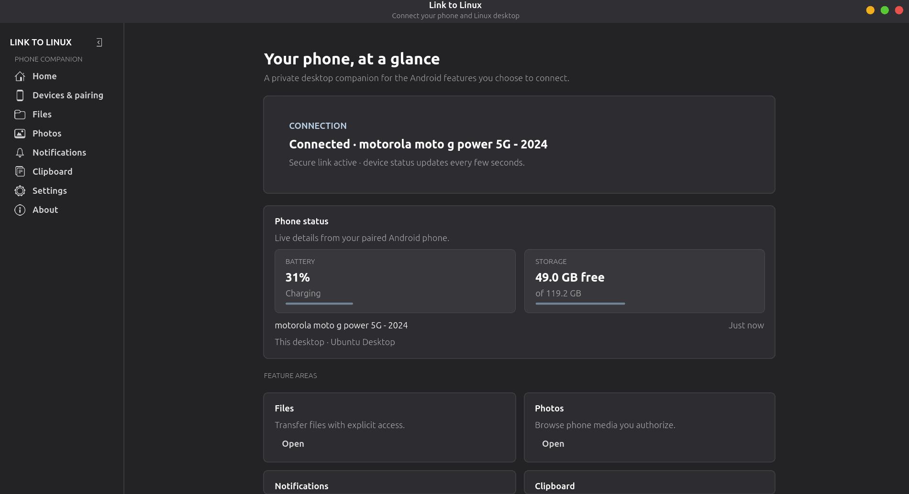

<p align="center">
  
</p>

<h1 align="center">Link to Linux</h1>

<p align="center"><strong>Your Android phone, connected to your Linux desktop.</strong></p>

Link to Linux is an independent phone companion for Linux, inspired by the convenience of Microsoft Link to Windows. Pair over your local network to share files, browse phone photos, view device status, control supported phone media sessions, forward notifications, and opt in to text clipboard sharing.

## Screenshots

### Desktop



### Android

<p align="center">
  
</p>

## Releases

### 1.1.0 · Current release

Adds live file-transfer progress on Android, fixes file-size labels, and improves remote input responsiveness with live text entry. The Remote input shortcut is now available in the Android bottom navigation. See the [1.1.0 changelog](./CHANGELOG.md).

Visit [GitHub Releases](https://github.com/Youngjay42-real/Link-to-linux/releases) for downloads and release history. To get notified when an update is published, choose **Watch → Custom → Releases** on the repository page.

| Download | Package |
| --- | --- |
| [Android APK](https://github.com/Youngjay42-real/Link-to-linux/releases/latest/download/LinkToLinux-Android.apk) | Android |
| [Debian/Ubuntu](https://github.com/Youngjay42-real/Link-to-linux/releases/latest/download/linktolinux_1.1.0_all.deb) | `.deb` |
| [Fedora](https://github.com/Youngjay42-real/Link-to-linux/releases/latest/download/linktolinux-1.1.0-1.noarch.rpm) | `.rpm` |
| [Portable Linux](https://github.com/Youngjay42-real/Link-to-linux/releases/latest/download/LinkToLinux-1.1.0-Linux.tar.gz) | `.tar.gz` |
| [Source archive](https://github.com/Youngjay42-real/Link-to-linux/releases/latest/download/LinkToLinux-1.1.0-source.tar.gz) | `.tar.gz` |

Media controls require Android notification access, an active media session, and an active paired connection. Other features may require additional Android permissions.

## Install

On Debian or Ubuntu, open the `.deb` in the system software installer. On Fedora, open the `.rpm` or run:

```bash
sudo dnf install ./linktolinux-1.1.0-1.noarch.rpm
```

For other Linux distributions, extract the portable archive and run `usr/bin/linktolinux`. GTK 4, libadwaita, Python 3.11+, PyGObject, Segno, and OpenSSL are required.

Install `LinkToLinux-Android.apk` on Android. Because the APK is distributed outside Google Play, Play Protect may warn about or block installation. Only install it if you trust that it came from this project's release page; if Android requires turning off app scanning, turn Play Protect back on immediately afterward. Notification access may separately require **Allow restricted settings** in the app info screen. See [Google Play Protect help](https://support.google.com/googleplay/answer/2812853).

## Pairing

Connect both devices to the same local network. Start pairing from **Devices & pairing** on the desktop, then scan the desktop QR code with Link to Linux on Android.

## About

Built by **Young Jay** at **YoungTechsperts**. [GitHub profile](https://github.com/Youngjay42-real) · [More projects](https://youngai.site) · [Join the Discord community](https://discord.gg/sMC9cV9nfU)

Link to Linux is an independent project and is not affiliated with Microsoft. Licensed under the MIT License.
